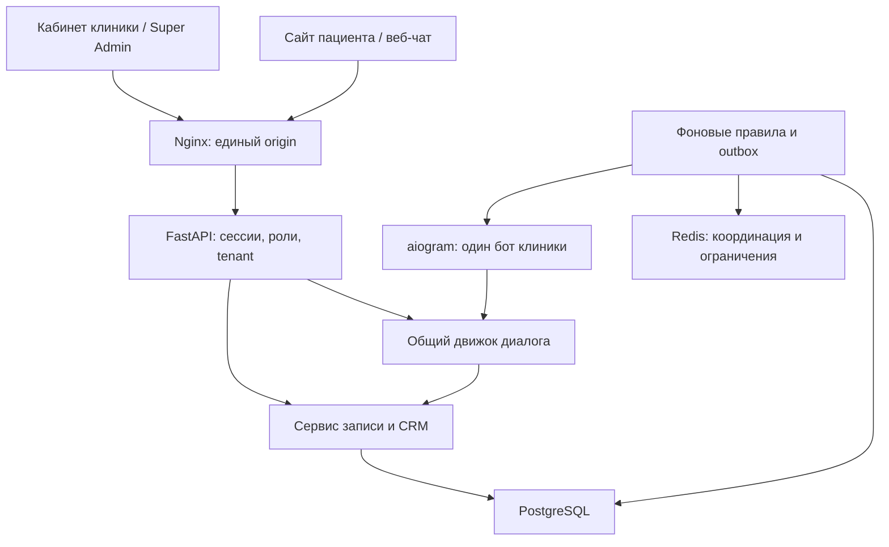

# Архитектура DentFlow

## Принцип

DentFlow — модульный монолит с отдельным интерфейсом. Медицинские карты, диагнозы, снимки и назначения в эту версию не включены. Вся работа с записями, пациентами, CRM и согласиями проходит через один FastAPI backend и одну выбранную PostgreSQL. Браузер не хранит имитацию БД в localStorage.



## Почему этот стек

| Выбор | Причина и компромисс |
|---|---|
| Next.js / React / TypeScript | Маршруты публичного сайта и кабинетов, единые компоненты, проверка типов. Standalone-сборка запускается на собственном сервере. |
| Tailwind CSS + собственные UI-компоненты | Лёгкая дизайн-система без отдельного стороннего генератора компонентов. Скопированных компонентов shadcn/ui нет. |
| FastAPI / Pydantic / SQLAlchemy | Явные схемы входа, проверка прав на сервере, общий бизнес-слой для чата и веб-записи. |
| PostgreSQL | Транзакции, внешние ключи, блокировки врачей и GiST-ограничение пересечения времени. SQLite разрешён только для изолированных тестов. |
| Redis | Общий rate limit и координация фонового процесса. В production сбой Redis блокирует публичные операции с явной ошибкой, а не снимает защиту. |
| Отдельный Python worker | Достаточен для фоновых правил MVP; durable outbox хранится в PostgreSQL. Celery можно добавить при росте объёма без изменения сервиса записи. |
| aiogram polling | Бот не требует отдельного публичного webhook. Один процесс соответствует одному боту и клинике. Для сети клиник нужны отдельные процессы/секреты. |
| Docker Compose + Nginx | Повторяемый запуск на российском VPS; меньше эксплуатационной сложности, чем Kubernetes и микросервисы. |

Версии зависимостей зафиксированы в `backend/requirements*.txt` и `frontend/package-lock.json`. Базовые Docker-образы закреплены по основной ветке: обновляйте их контролируемо, с CI и резервной копией. Для строгого релиза дополнительно закрепите digest проверенных образов.

## Окружения

| Окружение | База и конфигурация | Доступ |
|---|---|---|
| Development | `compose.development.yaml`, своя `dentflow_dev`, APP_ENV=development | Локальный порт 8081; отдельные ключи и volumes |
| Dev Stand | `compose.yaml`, `dentflow_devstand`, `.env`, devstand volumes | По умолчанию только 127.0.0.1:8080; удалённо через SSH-туннель |
| Production | `compose.production.yaml`, `dentflow_production`, `.env.production`, отдельные production volumes | Отдельный сервер в РФ, HTTPS reverse proxy, реальные секреты |
| Automated test | APP_ENV=test, `dentflow_test` или временная SQLite с test в имени | Синтетические данные, никогда production URL |

Production Compose — самостоятельный файл, а не overlay локального контура. Его значения жёстко выключают dev-инструменты и seed. Настройка production не мигрирует и не копирует демонстрационную БД. В коде seed/reset дополнительно проверяются окружение, имя БД и признак демо-клиники.

## Запись как единая транзакция

1. Backend определяет клинику по slug и проверяет её статус.
2. Пациент определяется по непрозрачной серверной сессии либо аккаунту Patient. Совпадение имени или непроверенного телефона не является доказательством личности.
3. Backend проверяет принадлежность врача, услуги и филиала одной клинике и возможность врача оказывать услугу.
4. Блокируется строка врача. Повторно проверяются рабочий день, перерыв, длительность и пересечение с активными записями.
5. Создаются запись, пациент при необходимости, CRM-лид, согласия, уведомление и аудит. Сохраняется ключ идемпотентности с привязкой к текущей личности.
6. Коммит делает изменения доступными кабинету клиники. Ошибка откатывает транзакцию; клиент получает 409 при конфликте.

Дополнительное PostgreSQL-ограничение `appointments_no_overlap` запрещает пересечение независимо от ошибки кода. Интервал `[start, end)` позволяет поставить соседние записи ровно в момент окончания предыдущей.

При переносе сохраняется длительность выбранного визита, проверяется новый интервал, старое время освобождается. Повторная отправка исходного запроса с тем же ключом не создаёт новую запись. Если содержимое изменено, сервер сообщает о конфликте.

## AI и каналы

`services/chat.py` отвечает за диалог и вызывает те же функции записи, что API. В режиме demo это детерминированный алгоритм с настоящими запросами к БД. Он не выдаётся за внешнюю нейросеть.

LLM-адаптеры классифицируют только административные фразы из ограниченного словаря. Неизвестные слова, имена, числа, медицинская информация и история переписки не отправляются. Возвращённый intent выбирает разрешённую ветку; модель не получает SQL, административные права или возможность самостоятельно подтвердить запись. Сложные свободные вопросы остаются локальному сценарию либо сотруднику.

Номер Telegram считается идентификатором только после получения приватного update от Telegram Bot API. Связывание с веб-профилем выполняется по случайному одноразовому коду, действующему 10 минут. Имя и телефон не используются для автоматического объединения.

## Уведомления и гарантии

Внутреннее уведомление — запись в БД, доступная пациенту и сотруднику. Это не SMS и не подтверждение доставки в сторонний мессенджер. Telegram outbox имеет состояния pending/sending/delivered/failed/suppressed, счётчик попыток и отложенный повтор.

Доставка Telegram имеет гарантию *at least once*: при сбое после принятия сообщения Telegram, но до фиксации результата в БД возможен повтор сообщения. Сама медицинская запись от этого не дублируется. Успех отправки означает принятие API, а не прочтение человеком.

## Границы эксплуатации

Tenant isolation выполняется на сервере: фильтры, проверки связей и роли. RLS PostgreSQL не настроен; прямой SQL-доступ персонала недопустим. Доступ DBA и инфраструктурного оператора требует отдельной политики. Неизменяемый внешний архив аудита, MFA, password recovery, полная наблюдаемость и нагрузочное масштабирование перечислены в ROADMAP.

Собственные домены поддерживаются через DNS, HTTPS и ручную конфигурацию reverse proxy для `/clinic/<slug>`. Автоматической проверки владения доменом и выпуска сертификатов из панели нет. Cross-site iframe зависит от браузерной политики cookies; основной способ интеграции — тот же origin через proxy или открытие виджета отдельной вкладкой.

## Отдельный контур разработчика

```bash
python3 scripts/configure.py --development
docker compose --env-file .env.development -f compose.development.yaml up -d --build --wait
```

Адрес http://localhost:8081. База dentflow_dev и volumes development-* отдельны от Dev Stand. Это изолированная контейнерная среда; при изменении исходников пересоберите образ. Для быстрой разработки можно отдельно запускать Next dev и uvicorn reload с собственной PostgreSQL и env, но не направляйте их на production.
